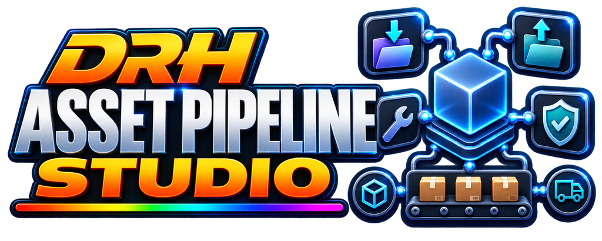
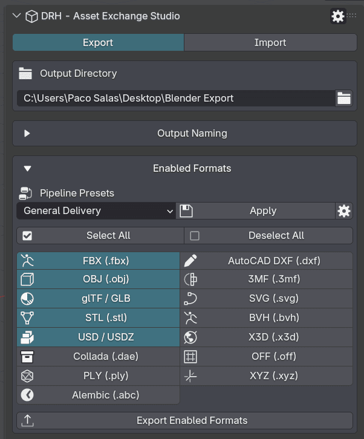
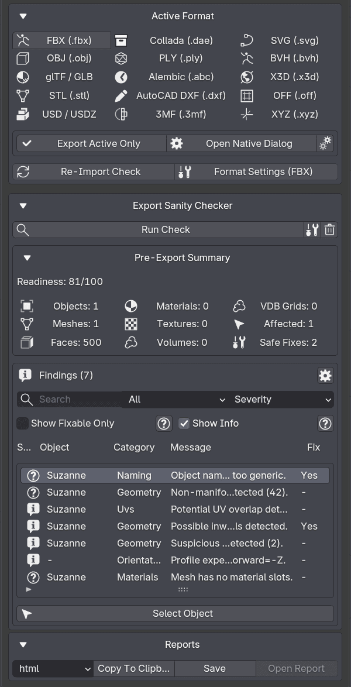

# DRH - Asset Pipeline Studio

**Client wants glTF, your engine wants FBX, the printer wants STL, and it's all the same model.**

  

 

## Where this stands

Built to v1.0.0, development paused. The manual and changelog are in this repository; there's no public download while it's on hold.

## What it does

Multi-format import and export from one production panel: export and import modes in the 3D View sidebar, File menu entries, batch export across the formats you enable, and directory import with scanning and filtering.

Pipeline presets ship for 3D Print, ArchViz, General Delivery, Godot, glTF Web, Marketplace, OBJ General, Unreal Engine, and Unity.

Validation is where it earns its keep. An export sanity checker, local report generation, and scene, object, material, texture, and delivery checks catch the missing texture or the unapplied scale before the file leaves. Collection routing sends imports to the current collection, the scene collection, per-file collections, or one you pick.

Everything runs locally. No account, no upload, no service call for normal operation.

## Who it's for

Technical artists moving assets between Blender and an engine. Marketplace creators who need the same asset in several delivery formats. Environment and CAD/ArchViz artists whose handoff has a checklist attached.

## Why it's paused

It's the largest tool of the five paused add-ons, and a pipeline tool that half-works is worse than none: people build a handoff around it and then lose an afternoon. It needs the full compatibility pass before a release.

[Open an issue](https://github.com/pacosalasv/DRH_Asset_Pipeline_Studio-Support/issues) if a preset or a validation check is the missing piece in your current workflow. Name the format pair you move between most.

Docs: [user manual](docs/manual/user-manual.pdf) · [CHANGELOG.md](CHANGELOG.md)

Released DRH add-ons, all free: [Blender tools on BlendKit](https://www.blendkit.com/?query=category_subtree:addon+author_id:205846) · [DRH Hub](https://github.com/pacosalasv/DRH_Addons_Hub)

  

